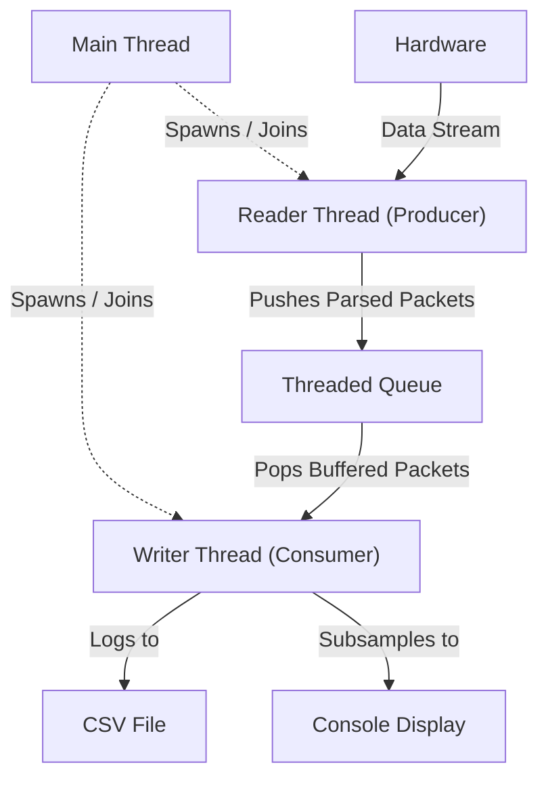

# Single-Producer Single-Consumer Queue Serial Logger

Uses a Single-Producer Single-Consumer (SPSC) Queue to coordinate data transfer between a `Producer` thread and a `Consumer` thread.

The `Producer` thread connects via UART to the board. The received bytes are saved into a buffer and a sliding window, capped to 6 bytes; when it reaches more than 6 bytes, the front of the double ended queue is discarded. If the front of the queue is 0x55 (sync byte) and the checksum is valid, the message gets pushed to the `ThreadedQueue` (class).

The `Message::verify()` method handles checksum validation.

The `ThreadedQueue` class has three methods: `push`, `pop`, `set_is_finished`. This class is used to handle one-way inter-thread transfers. Mutexes and Condition Variables are used to block access to the queue whilst a thread is using the resource, preventing simultaneous accesses and protecting atomicity.

The `Consumer` thread pops messages from the `ThreadedQueue`, and writes the message data to a CSV file, as well as the `std::cout` stream 3 times a second.

The MSB and LSB are combined by `Message::combine_msb_lsb()` in `Message.h`.

> The README describes my use case values. See `Config.h` to configure your own values.

## Usage

```sh
.\SPSC_Queue.exe <COMPORT> <DURATION_SECONDS> <OUTPUT_FILENAME?>
```

```sh
.\SPSC_Queue.exe COM4 120
.\SPSC_Queue.exe COM4 120 test_run
```

## Data and Thread Flow



## Related Projects

- [spsc-queue-rs](https://github.com/corey-richardson/spsc-queue-rs) (Rust implementation)
- [spsc-queue-tx](https://github.com/corey-richardson/spsc-queue-tx) (Transmitter)
