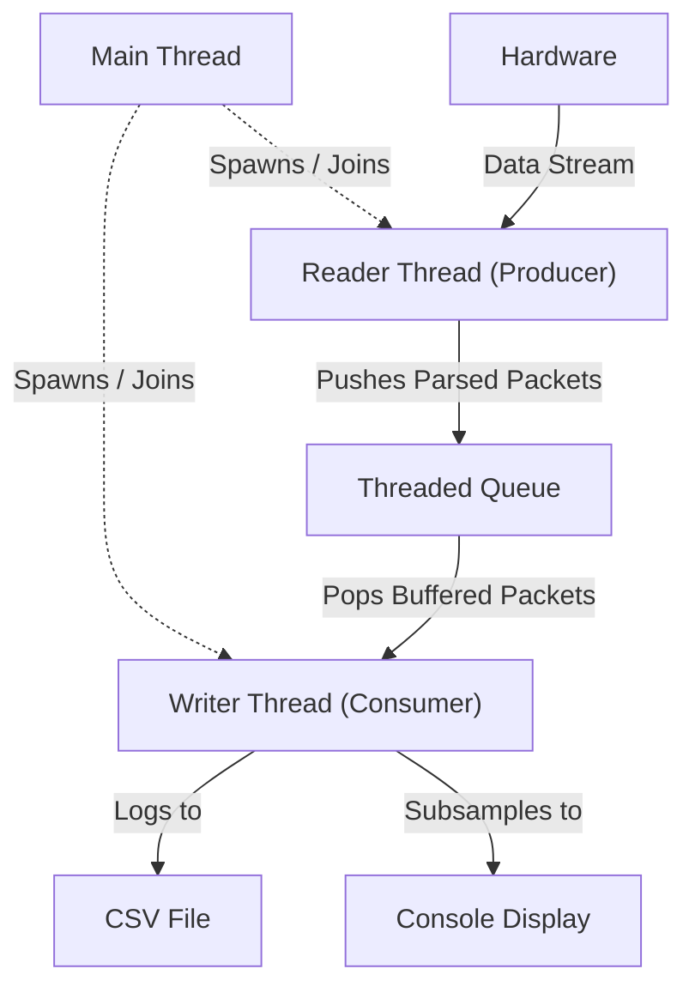

# Single-Producer Single-Consumer Queue Serial Logger

Logs serial UART data from hardware to a CSV file with throttled console output, using a thread-safe queue to decouple serial reading (`Producer`) from disk and console writing (`Consumer`).

## How It Works

- **Producer (`producer::reader_thread`):** Reads bytes from the UART port into a buffer and a sliding window capped at 6 bytes. When the window exceeds 6 bytes, the oldest byte at the front of the double-ended queue is discarded. If the front byte is `0x55` (sync byte) and `Message::verify()` succeeds, the parsed message is pushed to `ThreadedQueue`.
- **Queue (`ThreadedQueue`):** Provides one-way thread-safe transfer via `push`, `pop`, and `set_is_finished`, using a mutex and condition variable to synchronize access and signal completion.
- **Consumer (`consumer::writer_thread`):** Pops messages from `ThreadedQueue`, combines MSB/LSB fields via `Message::combine_msb_lsb()` (`Message.h`), writes rows to a CSV file, and prints updates to `std::cout` roughly 3 times per second.
- **Guards (`Guards.h`):** `guards::KeepAwake` prevents the display from sleeping during capture, and `guards::JoinThreads` ensures `producer` and `consumer` threads are joined on exception stack-unwinding.

> Default thresholds, frame sizes, and timing values reflect this project's use case. See `Config.h` to adjust them for your hardware.

## Project Structure

Built with C++20 in Visual Studio 2022:

- **`SPSC_Queue` (Executable):** Main application entry point (`main.cpp`) and serial/producer orchestration linking against `SPSC_Queue_Lib`.
- **`SPSC_Queue_Lib` (Static Library):** Core reusable components (`Message`, `ThreadedQueue`, and `Consumer` / `Producer` logic) compiled into a static library so both the application and test suite link against the same implementation.
- **`SPSC_Queue_Tests` (GoogleTest Suite):** Unit test suite linking against `SPSC_Queue_Lib` to verify program behaviour.

```
SPSC_Queue/                # Visual Studio Solution
├── SPSC_Queue/            # Main executable project
│   ├── Guards.h
│   └── main.cpp
├── SPSC_Queue_Lib/        # Static library project
│   ├── CliArgs.cpp
│   ├── CliArgs.h
│   ├── Config.h
│   ├── Consumer.cpp
│   ├── Consumer.h
│   ├── Message.h
│   ├── Producer.cpp
│   ├── Producer.h
│   ├── ThreadedQueue.cpp
│   └── ThreadedQueue.h
└── SPSC_Queue_Tests/      # GoogleTest project
    ├── cli_args.test.cpp
    ├── message.test.cpp
    └── threaded_queue.test.cpp
```

## Usage

```sh
.\SPSC_Queue.exe <COMPORT> <DURATION_SECONDS> <OUTPUT_FILENAME?>
```

```sh
.\SPSC_Queue.exe COM4 120
.\SPSC_Queue.exe COM4 120 test_run
```

Output files are written under the `Output/` directory.

## Data and Thread Flow



## Related Projects

- [spsc-queue-rs](https://github.com/corey-richardson/spsc-queue-rs) (Rust implementation)
- [spsc-queue-tx](https://github.com/corey-richardson/spsc-queue-tx) (Transmitter)
